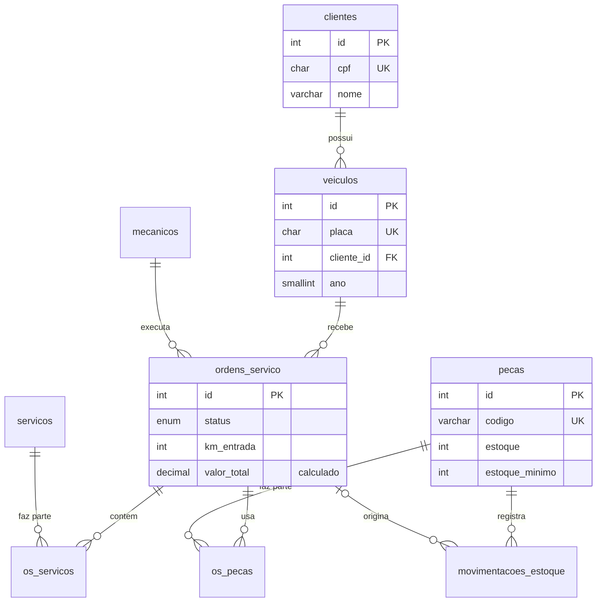

# Oficina Mecânica: banco de dados em MariaDB


Banco de dados completo para a gestão de uma oficina mecânica: clientes, veículos, ordens de serviço, catálogo de serviços, estoque de peças e relatórios gerenciais.

A ideia do projeto é deixar as regras de negócio **dentro do banco**. Mesmo que um sistema mal escrito tente gravar algo errado, o MariaDB não deixa: o estoque não fica negativo, a OS concluída não é alterada e o valor total está sempre certo.

## O que tem aqui

| Arquivo | Conteúdo |
|---|---|
| [`sql/01_tabelas.sql`](sql/01_tabelas.sql) | 9 tabelas com chaves estrangeiras, `UNIQUE`, `CHECK` (CPF, placa antiga e Mercosul, preços, estoque) e coluna calculada para o total da OS |
| [`sql/02_triggers.sql`](sql/02_triggers.sql) | 14 triggers: baixa e devolução de estoque, histórico de movimentações, recálculo de valores, bloqueio de OS concluída e de exclusão |
| [`sql/03_procedures.sql`](sql/03_procedures.sql) | Procedures do dia a dia (abrir OS, lançar serviço e peça, concluir, cancelar com transação, entrada de estoque) e uma função |
| [`sql/04_views.sql`](sql/04_views.sql) | Views de OS detalhada, peças para repor, faturamento mensal, desempenho dos mecânicos e histórico dos veículos |
| [`sql/05_dados_exemplo.sql`](sql/05_dados_exemplo.sql) | Dados fictícios de janeiro a outubro de 2026 (24 ordens de serviço) |
| [`consultas/relatorios.sql`](consultas/relatorios.sql) | Relatórios com CTE e funções de janela (`RANK`, `LAG`, `SUM() OVER`) |
| [`testes/testes.sql`](testes/testes.sql) | 30 testes automatizados das regras de negócio, escritos em SQL |

## Modelo de dados



## Regras garantidas pelo banco

- Peça lançada na OS **sai do estoque**; se for removida ou se a OS for cancelada, **volta**
- Não é possível usar mais peças do que há em estoque
- Toda entrada e saída fica registrada em `movimentacoes_estoque`
- Valores de serviços, peças e total da OS são **recalculados automaticamente**
- O primeiro item lançado muda a OS de `aberta` para `em_andamento`
- OS só é concluída se tiver pelo menos um serviço, e a data de conclusão é preenchida sozinha
- OS concluída ou cancelada não aceita mais alterações nem volta a ficar aberta
- OS nunca é excluída, só cancelada (o histórico é preservado)
- Um veículo não pode ter duas OS abertas, nem quilometragem menor que a da última visita

## Exemplos de relatórios

Faturamento mensal com acumulado e variação sobre o mês anterior:

```sql
SELECT mes,
       faturamento,
       SUM(faturamento) OVER (ORDER BY mes) AS acumulado,
       ROUND(100 * (faturamento - LAG(faturamento) OVER (ORDER BY mes))
                 / LAG(faturamento) OVER (ORDER BY mes), 1) AS variacao_pct
  FROM vw_faturamento_mensal;
```

```text
+---------+-------------+-----------+--------------+
| mes     | faturamento | acumulado | variacao_pct |
+---------+-------------+-----------+--------------+
| 2026-01 |     1375.20 |   1375.20 |         NULL |
| 2026-02 |     1536.80 |   2912.00 |         11.8 |
| 2026-03 |     1543.70 |   4455.70 |          0.4 |
| 2026-04 |     2234.90 |   6690.60 |         44.8 |
| 2026-05 |     3017.80 |   9708.40 |         35.0 |
```

Os outros relatórios trazem o ranking de clientes, os serviços que mais faturam, quantos dias o estoque de cada peça dura, os clientes sumidos para campanha de revisão e a quilometragem média entre trocas de óleo.

## Como rodar

**Com Docker** (cria o banco e carrega os dados de exemplo):

```bash
docker compose up -d
docker exec -i oficina-mariadb mariadb -uroot -poficina < testes/testes.sql
docker exec -i oficina-mariadb mariadb -uroot -poficina -t < consultas/relatorios.sql
```

**Com um MariaDB já instalado:**

```bash
for f in sql/0*.sql; do mariadb -uroot -p < "$f"; done
mariadb -uroot -p < testes/testes.sql
```

Usando a procedure para atender um cliente:

```sql
CALL sp_abrir_os('FRT-2A31', 4, 75000, 'Barulho na suspensao', @os);
CALL sp_adicionar_servico(@os, 8, 1);   -- troca de amortecedores
CALL sp_adicionar_peca(@os, 10, 2);     -- 2 amortecedores (baixa o estoque)
CALL sp_concluir_os(@os);
SELECT * FROM vw_ordens_detalhadas WHERE os_id = @os;
```

## Testes

A cada push, o GitHub Actions sobe um MariaDB 11.8 de verdade, cria o banco, roda os 30 testes e executa os relatórios. Os testes verificam cada regra acima, inclusive os casos de erro (por exemplo, que o banco **recusa** peça sem estoque).

```text
ok  peca usada sai do estoque
ok  bloqueia peca sem estoque suficiente
ok  cancelar devolve as pecas ao estoque
ok  OS concluida nao aceita novos itens
...
Todos os testes passaram
```

---

<details>
<summary>English</summary>

### Auto Repair Shop: MariaDB database

A complete database for an auto repair shop: customers, vehicles, work orders, a service catalog, parts inventory and management reports. Business rules live **inside the database**: 14 triggers keep inventory and totals consistent, stored procedures handle daily operations (including a transactional cancel), views feed the front desk and management, and reports use CTEs and window functions.

- Parts used on a work order are deducted from stock and returned if removed or cancelled
- Every stock movement is logged; order totals are recalculated automatically
- Completed or cancelled orders are locked; orders are never deleted
- 30 automated tests written in SQL run against a real MariaDB 11.8 on every push (GitHub Actions)

Run it with `docker compose up -d`, then execute `testes/testes.sql` and `consultas/relatorios.sql`.

</details>
